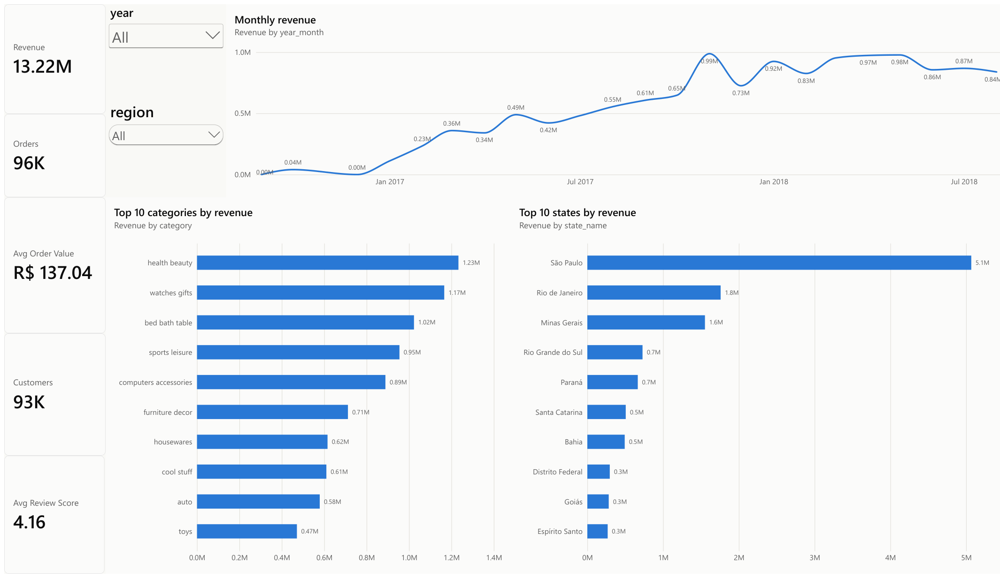
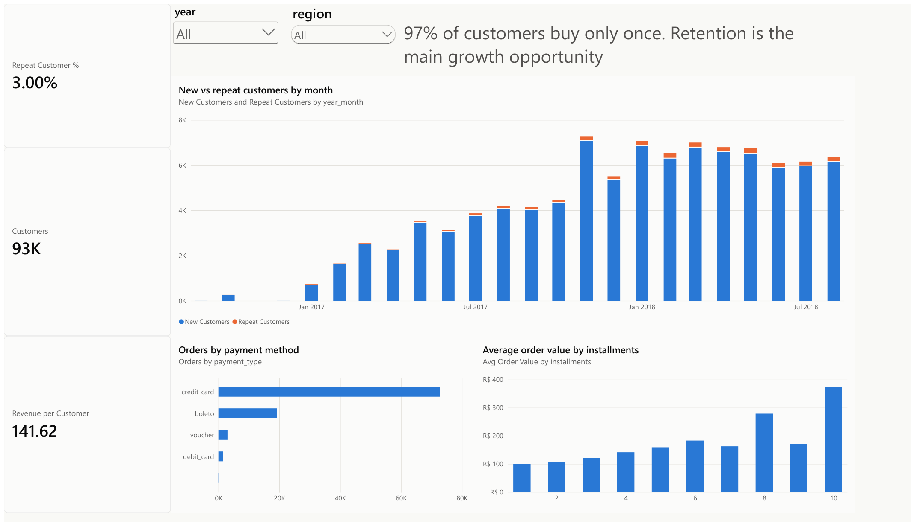
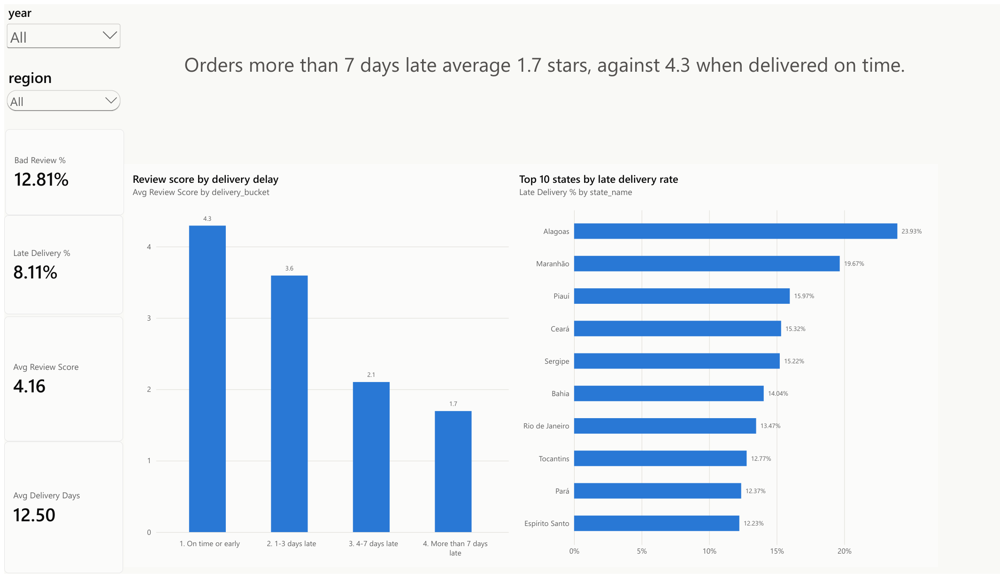

# Sales & Operations Dashboard — Power BI

A three-page Power BI dashboard for an e-commerce marketplace, built on a star schema modelled from ~100k real orders ([Olist dataset](https://www.kaggle.com/datasets/olistbr/brazilian-ecommerce), 2016–2018).

It answers three questions for a commercial and operations team:

1. **How is the business performing?** Revenue, orders, average order value, top categories and states.
2. **Are customers coming back?** New vs repeat customers, payment behaviour.
3. **Is delivery hurting satisfaction?** Late deliveries by state and their effect on review scores.

## Dashboard

> Screenshots are added once the report is built in Power BI Desktop.

| Executive Overview | Customers & Retention | Delivery & Satisfaction |
|---|---|---|
|  |  |  |

## Data model

A star schema with two fact tables sharing conformed dimensions, built in SQL ([star_schema.sql](sql/star_schema.sql)):

```
                 dim_date            dim_state
                  │    │              │    │
        ┌─────────┘    └────────┐ ┌───┘    └─────────┐
   fact_orders                  fact_order_items
   (1 row per order)            (1 row per item sold)
                                   │            │
                              dim_product   dim_seller
```

| Table | Grain | Rows |
|---|---|---|
| `fact_orders` | one order: status, delivery times, lateness, payment, review score | 99,441 |
| `fact_order_items` | one item sold: price, freight, product, seller | 112,650 |
| `dim_date` | one day, 2016–2018 | 1,096 |
| `dim_state` | Brazilian state with region | 27 |
| `dim_product` | product with English category | 32,951 |
| `dim_seller` | seller with location | 3,095 |

Design decisions:

- **Two facts, no fact-to-fact relationship.** Order-level measures (delivery, reviews, payments) live on `fact_orders`; item-level measures (revenue by category or seller) on `fact_order_items`. Both filter through the shared date and state dimensions.
- **The real customer key.** In the raw data `customer_id` is unique per order; customers are identified by `customer_unique_id`, which is what the retention measures count.
- **One review per order.** Orders with several reviews keep the most recent one.

## DAX measures

22 measures in [measures.dax](dax/measures.dax), covering sales, time intelligence (MoM, YTD, YoY), customer retention, delivery and satisfaction. For example:

```dax
Late Delivery % =
DIVIDE (
    [Late Orders],
    CALCULATE ( [Orders], NOT ISBLANK ( fact_orders[is_late] ) )
)
```

The model was validated against independent SQL results from my [SQL analysis project](https://github.com/esgana2520/ecommerce-sql-analysis): revenue R$ 13.22M, 96,478 delivered orders, 93,358 customers, 3.0% repeat customers.

## How to rebuild

Requires Python 3.10+ and Power BI Desktop.

```bash
pip install -r requirements.txt
```

Download the [Olist dataset](https://www.kaggle.com/datasets/olistbr/brazilian-ecommerce), extract the CSV files into `data/raw/`, then:

```bash
python scripts/build_model.py
```

This writes the six model tables to `data/model/` as CSV, ready to load into Power BI.

## Project structure

```
├── sql/star_schema.sql      star schema definition
├── scripts/build_model.py   builds data/model/ from the raw CSV files
├── dax/measures.dax         all DAX measures
├── theme/olist-theme.json   Power BI report theme
└── images/                  dashboard screenshots
```

## Tech stack

Power BI (data modelling, DAX), SQL on DuckDB, Python.
